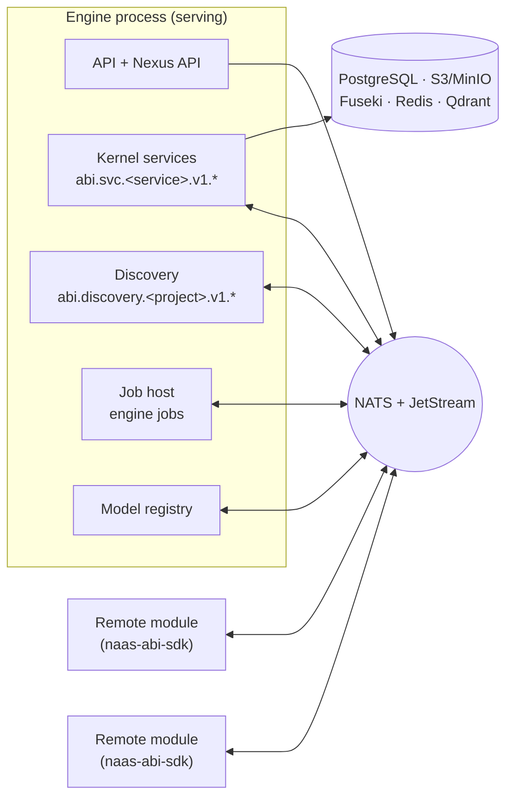
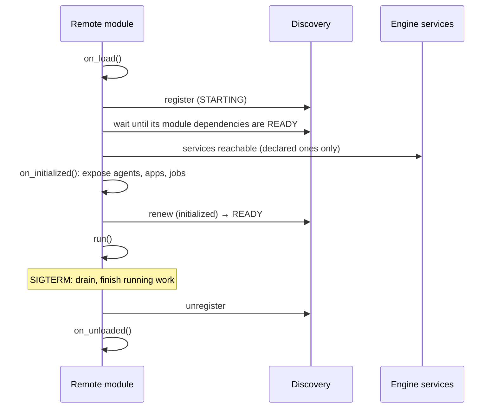

# NATS and the Kernel Services

Since 3.0, an ABI deployment runs on a [NATS](https://nats.io) broker. The
engine serves its kernel services (object storage, triple store, datasets,
documents, secrets and the rest) as request/reply endpoints on the broker. The
bus is JetStream, scheduled work runs as [module jobs](./remote-modules#module-jobs),
and modules can run in their own process and find each other through
**discovery**. The same broker carries all of it, so a module needs one
connection and nothing else: no port, no hostname, no database credential.

A project is in **NATS mode** when its config has a top-level `nats:` block.
`abi new project` writes one. Without it, the engine keeps the in-process
wiring of 2.x (see [Migrate from 2.x to 3.0](/upgrade/migrate-to-3)).



## The `nats:` block

```yaml
nats:
  # The broker, logged in as the user `abi` (the engine's user).
  nats_url: "nats://abi:{{ secret.NATS_ABI_PASSWORD }}@nats:4222"
  # Signs every service token. 32 bytes or more; never given to modules.
  jwt_secret: "{{ secret.NATS_JWT_SECRET }}"
  # One engine per project hosts the module registry.
  discovery:
    project: "my_project"
    lease_seconds: 180
  # The broker's HTTP monitoring port, read by the Nexus System app.
  monitoring_url: "http://nats:8222"
```

It sits at the top level, next to `api:`, not under `services:`. The other keys
have working defaults:

| Key | Default | Meaning |
|---|---|---|
| `client_timeout_seconds` | 10 | How long the engine's own service calls wait for a reply. |
| `max_concurrent_requests` | 64 | Calls each kernel service, and discovery, handles at once. |
| `discovery.project` | `default` | The discovery project: modules register under it. |
| `discovery.lease_seconds` | 20 | A module instance's lease. `abi new project` writes 180, so modules outlive an engine restart. |
| `object_storage_streaming.*` | 64 KiB chunks, 32 sessions | Chunked object transfers. |
| `models.streaming.*`, `models.generation_timeout_seconds` | 16 MiB per request, no deadline | Remote model calls. |
| `rpc_overflow.*` | 256 MiB per value | [Payloads above the broker limit](./remote-apps#large-payloads). |
| `jobs.enabled`, `jobs.retention.*`, `jobs.interrupt_grace_seconds` | on, 7 days, 5 s | [Module jobs](./remote-modules#module-jobs) hosted by this engine. |
| `engine.role`, `engine.rollout_id`, `engine.lease_seconds`, `engine.drain_seconds` | `serve`, empty, 20, 60 | [One serving engine](#one-serving-engine). |
| `monitoring_url` | none | The broker's monitoring endpoint, for the [System app](./observability). |

## Kernel services over NATS

Every kernel service has a versioned protobuf contract in
[`naas-abi-proto`](/reference/libraries/naas_abi_proto/overview): activity
log, cache, coding environment, dataset, document, email, event, key-value,
object storage, secret, source control, triple store and vector store. The
serving engine exposes each one as a NATS micro service on
`abi.svc.<service>.v1.<method>`, on a queue group.

In NATS mode the boundary holds **even inside one process**. Services and
modules loaded by the engine do not get each other's Python objects: they get
facades that send requests over NATS. So a service that runs in its own process
later needs no code change, and there is no local fallback: when the broker is
down, cross-service calls fail.

Calls follow the same rules everywhere:

- **Deadline.** A call waits 10 seconds by default (`client_timeout_seconds`,
  or the SDK's `timeout`), covering connect and request. Long dataset
  operations (`compact`, `flush`, `query`) take a deadline per call.
- **At most once.** A call is attempted once. A timeout or a lost connection
  may hide a write that completed: reconcile before you retry.
- **No responders.** When nobody serves the subject, the client sends again
  with a short backoff for up to 5 seconds, within the call's deadline. Nobody
  received the first request, so this is always safe; it hides the gap of an
  engine handover.
- **Errors** come back as typed codes (`RPCError.code` in the SDK), and every
  error reply carries an `Abi-Error-Code` header.
- **Authentication.** Each request carries a short-lived service token in its
  headers. See [Security model](./security).

Large values do not fail at the broker's 8 MiB message limit: object and model
transfers stream in chunks, other replies and requests overflow into chunked
sessions, and large reads stream. See [Large payloads](./remote-apps#large-payloads).

### Another engine's services

An engine can use a service that another engine owns: set the service's
adapter to `nats_rpc` on the engine that does not own it. This exists for every
kernel service except the model registry. Nothing enforces which engine owns a
service, so keep one owner per service, or owners on the same backend.

## JetStream

JetStream, the broker's persistence layer, holds what must outlive a process:

| Stream or bucket | What |
|---|---|
| Bus streams (`naas-abi-<hash>`) | The bus (`services.bus`), always JetStream in NATS mode. |
| `ABI_JOBS_<project>` | Module job triggers and schedules (JetStream message schedules, NATS 2.14 or later). |
| `abi_claim_checks` (object store) | Published messages above the broker limit. |
| `KV_ABI_ENGINE` | The serving engine's lease. |
| Discovery's key-value bucket | The module registry of each project. |

The engine that hosts discovery creates the jobs stream and the claim-check
store at start: modules may not create streams.

## One serving engine

Exactly one engine serves the kernel services per NATS account. It holds a
lease, the key `owner` in the key-value bucket `ABI_ENGINE`, renewed every
quarter of `nats.engine.lease_seconds` (20 s by default). A second engine that
tries to serve fails at start with `EngineAlreadyServing`, naming the holder's
host, pid, version and start time. This is what stops a second replica, a
second `abi dev up`, or a Dagster process from splitting requests between two
copies of every service.

An engine has one of three roles (`nats.engine.role`, or `ABI_ENGINE_ROLE`):

- **`serve`** (default): takes the lease, serves the kernel subjects and hosts
  the jobs.
- **`client`**: never serves and opens no backend; every service is a NATS
  client of the serving engine. For scripts and notebooks next to a running
  stack.
- **`auto`**: serves when no engine does, and is a client otherwise. `abi chat`,
  `abi run` and `abi agent list` use it.

### Deploys without downtime

Set `ABI_ROLLOUT_ID` (for example the image tag) on each deploy. A new engine
whose rollout id differs from the holder's **stands by**: it loads, reports
ready, and takes the lease when the old engine releases it. The old engine stops
its jobs, releases the lease, stops taking new calls, and finishes the calls and
transfers it already holds for up to `nats.engine.drain_seconds` (60 s). For a
moment both serve, rather than neither.

A serving engine with a rollout id refuses to start when a service it owns keeps
its data on local disk or in the process (SQLite, embedded Oxigraph or Qdrant,
`fs`): the next engine would answer from another copy. Development and
single-host setups keep those backends and deploy stop-then-start.

A holder that cannot renew for half a lease stops serving at once (fencing). A
crashed engine is replaced after one lease period. On Kubernetes: one
`ABI_ROLLOUT_ID` per deploy, `maxSurge: 1`, `maxUnavailable: 0`, a standby
counts as ready, and `terminationGracePeriodSeconds` above the jobs' run time
plus `drain_seconds`.

### When the broker is gone

nats-py reconnects for about two minutes (60 attempts, 2 s apart). After that
the API process stops (SIGTERM, then exit status 1 after 20 s), and so does an
SDK module, so a supervisor (Docker `restart: unless-stopped`, Kubernetes)
starts a fresh one. With `api.reload: true` the loss is only logged.

## Discovery

Discovery is the registry of the modules that run in their own process. It runs
in the serving engine, for the project named in `nats.discovery.project`, on
`abi.discovery.<project>.v1.*`. A module instance registers its
**descriptor**: its module id, version, contract major, the services and
modules it depends on, and the agents, jobs, models and apps it offers.

- An instance holds a **lease** and renews it about every 5 seconds. A clean
  stop unregisters at once; a crash is cleaned up when the lease expires.
- Its **status** is `STARTING` until its dependencies are ready and it has
  initialized, then `READY`. `DEGRADED` means a dependency went away; `STAGED`
  means a newer rollout waits for its whole cohort; `DRAINING` means it is
  stopping. Callers only use `READY` instances.
- The registry holds at most **256 live instances and 512 KiB** per project.
- **Rollouts.** Instances started with the same `ABI_ROLLOUT_ID` (and
  `ABI_ROLLOUT_MODULES`) cut over together: the previous generation stays
  ready until every module of the new one is up, then drains.
- A module registers **only as itself**: its token must assert its module id
  (see [Module identities](./security#module-identities)).

Nexus reads discovery to list remote agents next to the engine's, and remote
apps on the Apps page. The System app's **Modules** tab shows every instance.

## The module lifecycle

Engine modules (the ones under `modules:` in the config) load inside the
engine, as in 2.x. In NATS mode the engine starts a job host for each module
that declares jobs, once the module is initialized.

Remote modules (built with `naas-abi-sdk`) run under `run_module` and follow
the same hooks:



A module declares the services it calls (`ModuleDependencies(services=...)`)
and the modules it depends on (`modules=...`); undeclared calls are refused.
It binds its agents, apps and job handlers in `on_initialized`, before it
becomes `READY`. On `SIGTERM` it stops taking new work, finishes the agent runs
and jobs it started, and unregisters. Read on in
[Remote modules and jobs](./remote-modules).

→ [Remote modules and jobs](./remote-modules)
