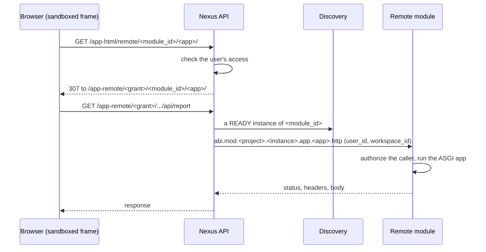

# Remote Apps and Large Payloads

A remote module ships web apps without a port, a hostname or a route of its
own: Nexus stays the only HTTP entry point and forwards each request to the
module over NATS. This page covers how that works, and how ABI carries values
larger than one NATS message (8 MiB by default) everywhere else.

## Remote apps

Each `apps/<name>/manifest.json` next to a module's package is an app.
Discovery announces it, Nexus lists it on the Apps page while an instance of
the module is `READY`, and the module answers its requests:

- **Files** of the app folder (HTML, scripts, styles, images, fonts, JSON) are
  served as they are.
- **Any other request** goes to the ASGI application the module bound with
  `self.expose_app(name, asgi_app)` in `on_initialized` (FastAPI, Starlette).
  It runs in the module's process, without an HTTP server, with `root_path`
  set to the Nexus path, and its lifespan runs with the module.

### What the app receives

`request.scope["abi"]` holds:

- `user_id`: the signed-in Nexus user;
- `workspace_id`: the Nexus workspace the user opened the app from, one where
  the app is enabled;
- `caller`: the service identity that sent the request.

Only Nexus (the `api` identity) may name a user or a workspace. A request from
any other caller that names one is refused with `PERMISSION_DENIED` before the
app runs, so another module can call an app, but never on behalf of a user.
Keep each workspace's data apart with `workspace_id`. Nexus never forwards the
user's credential (`Authorization`, cookies of the Nexus session).

### Sandbox and grants

A remote app's page runs in a sandboxed frame with an opaque origin, apart
from the Nexus session:

- The page is served at `/app-remote/<grant>/<module_id>/<app>/<path>`. The
  **grant** in the URL is its only credential: it opens one app, as one user,
  in one workspace, for 8 hours (`REMOTE_APP_GRANT_EXPIRE_MINUTES`, default
  480). A grant ends at the user's logout (on any device), password change, or
  `POST /api/apps/remote-grant/revoke`. The Apps page mints it with
  `POST /api/apps/remote-grant` and a `workspace_id`.
- Use URLs relative to the page, or built from `root_path`: both keep the grant.
- `localStorage`, `sessionStorage` and `document.cookie` throw. Keep state in
  memory or in the backend.
- The page's `fetch()` calls are cross-origin and carry no cookie. A module's
  cookie is kept only with a `Path` under the app's root and no `Domain`.
- Headers pass on allow-lists in both directions (and a deny-list of proxy
  control headers for the app's own `x-` response headers).

### Bodies and limits

- Bodies up to 256 KiB travel inline. Larger uploads stream to the app as it
  reads `request.stream()`, never faster, so a module can pass an upload on
  without holding it: `put_object_stream(prefix, key, request.stream())`.
- Responses sent in parts or larger than 256 KiB stream as the browser reads
  them: downloads, large files, server-sent events. Set `Content-Length` when
  you know it, so a browser tells a cut download from a whole one.
- Nexus refuses uploads above the app's `max_upload_bytes` (manifest; default
  1 GiB), and the module stops reading there too. Uploads run on 16 slots per
  module process (`AppHost(max_uploads=16)`), apart from other requests.
- Timeouts are idle limits: an app that neither reads nor answers for 60 s gets
  504. There is no total limit.
- An exception the app raises, an `RPCError` of a service it called included,
  is a 502. WebSockets are not supported yet.
- A module caches an authorization for 5 seconds, so an instance that just lost
  `READY` may serve a request within that window.

`abi new app <name> apps` inside a remote module creates the folder; the
remote module template shows how to bind a backend.

## Large payloads

The broker's `max_payload` stays at 8 MiB, the NATS recommendation: larger
messages block a connection for everyone on it. ABI never raises it. Instead,
each kind of traffic has its own way past it.

| Traffic | Above the limit | Limits |
|---|---|---|
| Object storage reads and writes, model calls | **Transfers**: chunked sessions (`transfer/v1`) | 64 KiB chunks; `nats.object_storage_streaming.*`, `nats.models.streaming.*` |
| Any other service request or reply | **RPC overflow** | 256 MiB per value |
| Large reads (graphs, SPARQL results, dataset queries, vector listings, event and activity logs) | **Streamed results** | One batch (about 256 KiB) in memory per hop |
| Published messages: the bus, live events, job triggers | **Claim checks** | 256 MiB per message, kept 7 days |
| Remote app bodies | Streamed bodies (above) | `max_upload_bytes`, 1 GiB by default |

### Transfers

Object `get_object` and `put_object` above 64 KiB, and every model request and
stream, go through chunked transfer sessions owned by one engine instance.
`get_object_stream` and `put_object_stream` keep memory bounded. A transfer
cannot resume after its owner restarts, and an uncertain operation is never
replayed.

### RPC overflow

Every other kernel call is one request and one reply. When a reply does not fit,
the engine parks it in a read-only session bound to the caller and answers with
an `Abi-Overflow-Reply` header; the client reads the chunks and decodes the
normal response. A request that does not fit is uploaded first, then sent with
`Abi-Overflow-Request`. Small calls are unchanged. Values are still held whole
in memory on both ends, up to 256 MiB (`nats.rpc_overflow`); above that, or at
capacity, the call fails with `PAYLOAD_TOO_LARGE` or `RESOURCE_EXHAUSTED`.

### Streamed results

For values that should never be held whole, the services stream:

- triple store: `query_stream(sparql)` and `export(graph_name)`, as context
  managers that yield rows or triples;
- dataset: `query_stream(sql, ...)` and `write_stream(name, rows, ...)`;
- vector store: `list_vectors_stream(...)`;
- event and activity log: `query_stream(...)`;
- document `find`: pages bounded by size as well as count.

A stream is read once, inside its `with` (or `async for` in the SDK). It holds a
backend response or a transfer session until it ends, and expires after 60
seconds without a read. An error after the first rows raises from the
iterator; nothing is retried once rows were yielded.

### Claim checks

A published message above the broker limit (a bus message, a live event, a job
trigger) is stored in the JetStream object store `abi_claim_checks` and sent as
an empty body with an `Abi-Claim-Check` header. Subscribers, workers and job
handlers receive the whole payload, transparently. A stored value expires after
7 days, so a queued or scheduled message must be read within that time, and it
costs JetStream storage until then, also after every reader saw it. Raw NATS
readers outside ABI's helpers see the reference, not the payload.

→ [Security model](./security)
