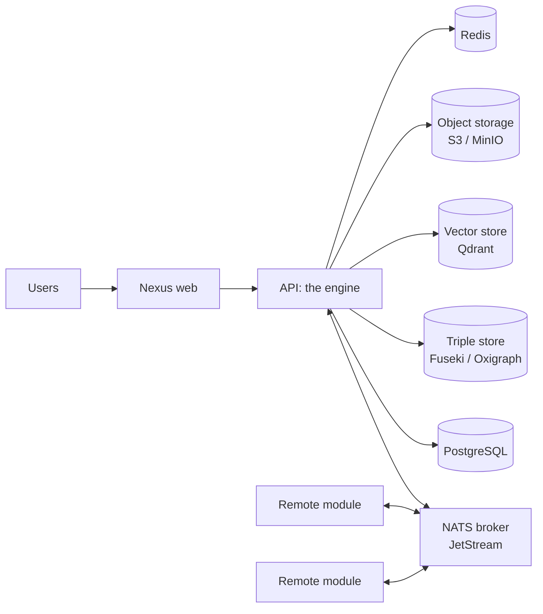

# Production and remote deployments

How to run a project on servers that are not your laptop, and which pieces to run
yourself or take as a service. [Dokploy](/user-guide/deploy/dokploy) and
[Docker](/user-guide/deploy/local-docker) are ready-made ways to do it on one host; this
page is for everything else: your own Compose or Kubernetes, a container platform, Naas
Spaces, a managed NATS.

---

## The pieces of a production project



| Piece | Notes |
|---|---|
| **The engine** (`python -m naas_abi_core.apps.api.api`) | Serves the API, Nexus's backend and the kernel services over NATS, and hosts the module jobs. **One serving engine per NATS account.** |
| **Nexus web** | The web app; it calls the API. |
| **The NATS broker** | 2.14 or later, JetStream on. See [the broker](#the-broker). |
| **Remote modules** | One container each, any number of replicas. They reach the engine only through the broker. |
| **Backing services** | Whatever `services:` points at: PostgreSQL (documents, Nexus), a triple store, Qdrant, S3-compatible storage, Redis. |
| **A model provider** | A cloud key (OpenRouter by default) or your own inference endpoint. |

All of them must be restarted when they stop: the API and the SDK modules exit when the
broker is unreachable for about two minutes, on purpose, so a supervisor (Docker
`restart: unless-stopped`, Kubernetes) starts a fresh one. See
[When the broker is gone](/developer-guide/architecture/nats#when-the-broker-is-gone).

---

## `config.remote.yaml`

A project made by `abi new project` has one config per environment. The engine reads
`config.<ENV>.yaml` when `ENV` names a file that exists, so a deployment sets `ENV=remote`
and gets `config.remote.yaml`:

| What it sets | How |
|---|---|
| Secrets | A dotenv adapter on `.env.remote`: keep the production values in that file (never commit it) or in the platform's environment variables, which win over the file. |
| The broker | `nats.nats_url: "{{ secret.NATS_URL }}"`, logged in as the broker user `abi`, and `nats.jwt_secret: "{{ secret.NATS_JWT_SECRET }}"`. |
| Backends | PostgreSQL (`services.document`), S3-compatible object storage, Fuseki, Qdrant and Redis, each from `{{ secret.* }}` host, port and credentials. |
| Models | `ai_mode: "cloud"` with the OpenRouter module, so the host needs no inference hardware. Ollama is opt-in and needs a server the app can reach (`ABI_OLLAMA_BASE_URL`). |
| Public hosts | `PUBLIC_WEB_HOST` and `PUBLIC_API_HOST`, which feed `cors_origins` and `public_api_host`. |

```yaml
nats:
  nats_url: "{{ secret.NATS_URL }}"              # nats://abi:<password>@broker.internal:4222
  jwt_secret: "{{ secret.NATS_JWT_SECRET }}"     # 32 bytes or more; never given to modules
  discovery:
    project: "my_ai"
    lease_seconds: 180
  monitoring_url: "http://broker.internal:8222"  # optional: the System app's NATS tab
```

Check it before you ship it:

```bash
ENV=remote abi config validate --modules
```

`abi config validate --modules` also imports each enabled module and validates its
config. Every `{{ secret.X }}` of the active YAML must resolve, or the engine refuses to
load: add each key to the environment or to `.env.remote`. See
[Configuration](/user-guide/get-started/configuration#environment-files).

Give any second engine of the project (a worker, a notebook) a config **without** the
`discovery:` block: exactly one engine per project hosts the module registry.

---

## The broker

The engine and every remote module need one broker. Run it next to the project, or take a
managed NATS cluster, as long as it provides:

- **JetStream**, on persistent storage. It holds the bus, the module jobs, the engine's
  lease and discovery.
- **nats-server 2.14 or later**: module jobs use JetStream message schedules, and time
  zones on cron triggers need 2.14.
- **A `max_payload` of 8 MB**: the largest value NATS recommends. Bigger values stream in
  chunks.
- **Two users**: `abi` (the engine: every right) and `module` (remote modules), with the
  `module` user denied the engine's own subjects and the JetStream administration API.
  The `nats.conf` that `abi deploy local` writes under `.deploy/docker/nats/` is the
  reference: copy its `authorization` and `MODULE_PERMISSIONS` blocks to your broker's
  configuration, or translate them to your provider's permission model.
- **A private network.** Traffic to NATS is not encrypted and the monitoring port has no
  authentication. Put the broker where only the engine and modules reach it.

Each remote module gets its own key, derived from `NATS_JWT_SECRET`
(`abi module key <module_id>`); it signs the module's tokens for that id only and the
module never holds the secret. Pass it as `ABI_MODULE_KEY`, with `ABI_NATS_URL` set to
the broker URL logged in as `module`.

:::note Managed NATS
ABI is built and tested against the `nats-server` 2.14 it runs itself. A managed service
works when it offers the list above; check the permission model of your provider against
`MODULE_PERMISSIONS` before you put a module on it, and run the NATS integration checks
(`abi dev up`, then the System app's Modules and Jobs tabs) against it before you depend on
it. See [Security model](/developer-guide/architecture/security).
:::

---

## Deploy without downtime

Set `ABI_ROLLOUT_ID` (for example the image tag) on each deploy. The new engine stands by,
takes over when the old one stops, and a serving engine with a rollout id needs shared
backends (PostgreSQL, S3, Fuseki, Qdrant), not SQLite or local files. On Kubernetes use one
rollout id per deploy, `maxSurge: 1` and `maxUnavailable: 0`. The details are in
[one serving engine](/developer-guide/architecture/nats#one-serving-engine). Remote modules
scale on their own: replicas share a module's agent runs and jobs.

---

## Your own Docker Compose or Kubernetes

The image is the project's `Dockerfile`: it installs the project with `uv sync --no-dev`
and runs `python -m naas_abi_core.apps.api.api` on port 9879. Build it for your platform:

```bash
docker build -t my_ai:latest .
docker run --rm -p 9879:9879 -e ENV=remote --env-file .env.remote my_ai:latest
```

To start from a working stack, run `abi deploy local` and take `docker-compose.yml`,
`.deploy/` and `docker-compose.override.yml` as the base: they hold every service with its
health checks, volumes and the module services. Put TLS in front with your reverse proxy
(Caddy, Traefik, Nginx, an ingress). Keep the broker, the databases and the object store on
a private network, and back up their volumes. See [High availability and disaster
recovery](/user-guide/deploy/high-availability) and [Security and
compliance](/user-guide/deploy/security-compliance).

---

## Naas Spaces

`abi deploy naas` builds the project's image, pushes it to a Naas container registry and
creates or updates a Naas Space that runs it (one `api` container on port 9879, 1 CPU,
1 GiB). It reads a `deploy:` section from `config.<env>.yaml` (`-e prod` by default, so
`config.prod.yaml`, else `config.yaml`):

```yaml
deploy:
  workspace_id: "<your Naas workspace id>"
  space_name: "my-ai-api"
  naas_api_key: "{{ secret.NAAS_API_KEY }}"
  env:                                   # environment variables of the container
    ENV: "remote"
    NATS_URL: "{{ secret.NATS_URL }}"
    NATS_JWT_SECRET: "{{ secret.NATS_JWT_SECRET }}"
    OPENROUTER_API_KEY: "{{ secret.OPENROUTER_API_KEY }}"
```

```bash
abi deploy naas                          # needs Docker and a Naas subscription with Spaces
```

It prints the Space's URL (`https://<space_name>.default.space.naas.ai`). A Space runs
the engine only: in NATS mode give it a broker it can reach (a managed NATS, or one you
host) and the backing services in `env`. A project made by `abi new project` includes a
GitHub Actions workflow (`.github/workflows/release.yaml`) that runs `abi deploy naas` on
every push to `main`, with `ENV=prod` and `NAAS_API_KEY` as a repository secret.

---

## Secrets

Production secrets reach the engine as environment variables or through a secret adapter
chain (`services.secret.secret_adapters`: dotenv, Naas, base64). See
[Add secrets to production](/user-guide/deploy/add_secrets_to_production).

## Next

- [Deployment models](/user-guide/deploy/deployment-models): cloud, on premises, air gapped, managed.
- [Publish remote agents](/user-guide/deploy/publish_remote_agents).
- [Upgrade to 3.0](/user-guide/upgrade/migrate-to-3), when the project is a 2.x one.
